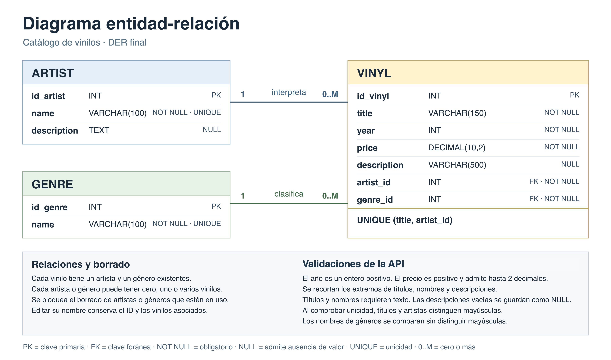

# API de vinilos

API REST para administrar un catálogo de vinilos. Permite consultar, crear, editar y borrar vinilos, artistas y géneros, y filtrar el catálogo por título y artista.

Está hecha con **Python**, **FastAPI**, **Pydantic**, **SQLAlchemy** y **SQLite**. Uvicorn ejecuta el servidor y Swagger UI permite probar las rutas desde el navegador.

## Arranque local

El entorno de referencia es macOS con Python 3.15.2. Ejecuta los comandos desde la carpeta del backend.

### 1. Obtener el código e instalar las dependencias

```bash
git clone --branch develop https://github.com/hanyueyang949/api-vinyl.git
cd api-vinyl
python3 -m venv .venv
source .venv/bin/activate
python -m pip install --only-binary=watchfiles -r requirements.txt
```

La rama `develop` contiene la API descrita en esta guía. Si ya tienes el repositorio descargado, sitúate en esa rama antes de crear el entorno virtual.

### 2. Configurar SQLite

Crea un archivo `.env` junto a `main.py`. Si ya existe, revisa su configuración.

```dotenv
DATABASE_URL=sqlite:///./vinyl.db
```

Con esta configuración, SQLite guarda los datos en `vinyl.db` dentro del backend. Git ignora el archivo de configuración y el de la base de datos.

### 3. Crear las tablas

```bash
python -c "from database.database import Base, engine; from models import artist, genre, vinyl; Base.metadata.create_all(engine)"
```

El comando crea las tablas `artists`, `genres` y `vinyls` si faltan y conserva los registros existentes.

### 4. Arrancar y hacer la primera consulta

```bash
python -m uvicorn main:app --reload
```

Abre [Swagger UI](http://127.0.0.1:8000/docs). Para probar una ruta, pulsa **Try it out** y después **Execute**. En una base recién creada, [el listado de vinilos](http://127.0.0.1:8000/vinyls) devuelve `200` con `[]`. Al terminar, detén el servidor con `Ctrl+C`.

Para un cliente web local, CORS admite el origen `http://127.0.0.1:5500`. El navegador considera `http://localhost:5500` un origen distinto.

## Modelo de datos



- Cada vinilo pertenece a un artista y a un género existentes. Un artista o género puede tener cero o más vinilos.
- Cada artista puede tener un solo vinilo con un título dado. Artistas distintos pueden publicar vinilos con el mismo título.
- Para borrar un artista o género, primero hay que borrar o reasignar los vinilos que lo referencian.

## Endpoints

En las rutas con llaves, sustituye el parámetro por el ID que devuelve la API al crear el registro.

| Método y ruta | Operación | Éxito |
| --- | --- | --- |
| `GET /vinyls` | Listar vinilos con su artista y género. Acepta filtros opcionales. | `200` |
| `GET /vinyls/{vinyl_id}` | Consultar un vinilo con su artista y género. | `200` |
| `POST /vinyls` | Crear un vinilo. | `201` |
| `PUT /vinyls/{vinyl_id}` | Actualizar un vinilo. Envía de nuevo todos los campos obligatorios. | `200` |
| `DELETE /vinyls/{vinyl_id}` | Borrar un vinilo. | `204` |
| `GET /artists` | Listar artistas. Cada elemento incluye `id_artist` y `name`. | `200` |
| `GET /artists/{id_artist}` | Consultar un artista con su descripción. | `200` |
| `POST /artists` | Crear un artista. | `201` |
| `PUT /artists/{id_artist}` | Actualizar un artista. | `200` |
| `DELETE /artists/{id_artist}` | Borrar un artista sin vinilos asociados. | `204` |
| `GET /genres` | Listar géneros. Cada elemento incluye `id_genre` y `name`. | `200` |
| `GET /genres/{id_genre}` | Consultar un género. | `200` |
| `POST /genres` | Crear un género. | `201` |
| `PUT /genres/{id_genre}` | Actualizar un género. | `200` |
| `DELETE /genres/{id_genre}` | Borrar un género sin vinilos asociados. | `204` |

### Campos al crear o actualizar

| Recurso | Campos |
| --- | --- |
| Artista | `name` obligatorio, de hasta 100 caracteres. `description` opcional y admite `null`. |
| Género | `name` obligatorio, de hasta 100 caracteres. |
| Vinilo | `title` obligatorio, de hasta 150 caracteres. `year` entero positivo. `price` positivo y admite hasta dos decimales. `artist_id` y `genre_id` enteros positivos que apuntan a registros existentes. `description` opcional, admite `null` y tiene un máximo de 500 caracteres. |

La API recorta los espacios al principio y al final de nombres, títulos y descripciones. Los nombres y títulos deben contener texto. Una descripción vacía se guarda como `null`. Los nombres de géneros son únicos sin distinguir mayúsculas. Para los nombres de artistas y los títulos de vinilo, la unicidad distingue mayúsculas.

### Filtros del catálogo

`GET /vinyls?artist=Michael&title=Thriller` busca coincidencias parciales por nombre del artista y título del vinilo. Puedes enviar uno, ambos o ninguno. Si envías ambos, se deben cumplir los dos. Si no hay coincidencias, la respuesta es `200` con `[]`.

### Respuestas principales

| Código | Cuándo aparece |
| --- | --- |
| `200` | Consulta o actualización correcta. |
| `201` | Registro creado. |
| `204` | Borrado correcto. La respuesta no tiene cuerpo. |
| `404` | No existe el registro consultado o la referencia a un artista o género al guardar un vinilo. |
| `409` | Hay un duplicado o un conflicto con los datos, como intentar borrar un artista que tiene vinilos. |
| `422` | Faltan campos obligatorios o algún valor no cumple la validación, como un precio de cero o un ID de ruta que no es entero. |

## Ejemplo desde Swagger

1. Ejecuta `POST /artists` con `{"name":"Michael Jackson"}` y anota el `id_artist` de la respuesta.
2. Ejecuta `POST /genres` con `{"name":"Pop"}` y anota el `id_genre`. Si el artista o el género ya existen, consulta sus IDs con `GET /artists` o `GET /genres`.
3. Ejecuta `POST /vinyls` con este JSON. Sustituye `artist_id` y `genre_id` por los valores obtenidos.

```json
{
  "title": "Thriller",
  "year": 1982,
  "price": "27.90",
  "description": "Álbum de Michael Jackson.",
  "artist_id": 1,
  "genre_id": 1
}
```

La creación devuelve `201` con el nuevo `id_vinyl` y los campos del vinilo. El precio se devuelve como texto con dos decimales. Al consultar ese ID con `GET /vinyls/{vinyl_id}`, la API añade el artista y el género. Por ejemplo, si los tres IDs son `1`:

```json
{
  "id_vinyl": 1,
  "title": "Thriller",
  "year": 1982,
  "price": "27.90",
  "description": "Álbum de Michael Jackson.",
  "artist_id": 1,
  "genre_id": 1,
  "artist": {
    "id_artist": 1,
    "name": "Michael Jackson"
  },
  "genre": {
    "id_genre": 1,
    "name": "Pop"
  }
}
```
